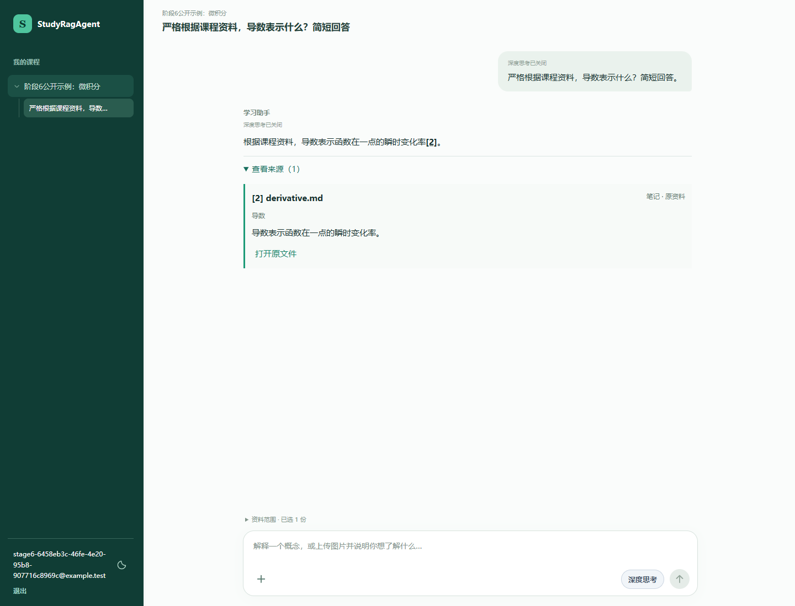
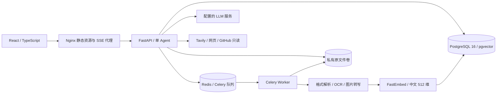

# Study RAG Agent

面向个人课程资料的学习助手：上传笔记、课件、教材与题目图片，用自然语言提问，并打开可核对的来源。每个账号的课程、资料、会话和附件独立隔离。

- PDF、DOCX、PPTX、TXT、Markdown、JPEG/PNG/WebP 异步解析、状态查看与重试。
- 图文问答、数学公式、深度思考开关、会话重命名与资料范围选择。
- 单个 LangGraph Agent 按需使用课程检索、公开网页搜索、GitHub 只读工具。
- 服务端校验来源权限与编号，AI 核对答案；必要时进行一次有界修正。
- 本地 Docker 部署、隔离备份恢复、自动化测试与 GitHub Actions。

公开仓库：[2637992304-oss/StudyRAGAgent](https://github.com/2637992304-oss/StudyRAGAgent)。质量与边界见[验收报告](docs/stage6/report.md)。



## 架构



后端 Python 3.11+、FastAPI、SQLAlchemy 2、Alembic；前端 React 19、TypeScript、Vite、KaTeX。容器使用 Python 3.13 / Node 22。依赖由 `backend/uv.lock` 和 `frontend/package-lock.json` 固定。

## 快速启动：完整容器环境

需要 Git、Docker Desktop（Linux 容器）或 Docker Engine + Compose v2。初次构建需要下载基础镜像和依赖，首次资料处理需要下载中文 Embedding 模型。

```powershell
git clone https://github.com/2637992304-oss/StudyRAGAgent.git
cd StudyRAGAgent
Copy-Item .env.example .env
```

Linux/macOS 对应复制命令为 `cp .env.example .env`。编辑本机 `.env`：

| 配置 | 用途 |
| --- | --- |
| `AUTH_SECRET` | 换成长随机值；改变后旧登录令牌失效 |
| `LLM_BASE_URL`、`LLM_MODEL`、`LLM_API_KEY` | 服务端模型地址、模型名和自有密钥；默认模板对应已验证的 DeepSeek 扩展协议 |
| `TAVILY_API_KEY` | 可选；不填时不提供网页搜索工具 |
| `GITHUB_CREDENTIALS` | 可选；精确账号/仓库范围的私有仓库只读 Token，公共仓库通常匿名读取 |
| `WEB_PORT` | 网页端口，默认 8080 |
| `POSTGRES_PORT`、`REDIS_PORT` | 本机开发端口；与已有服务冲突时更换 |

数据库密码若用于模板自动拼接连接串，请使用 URL 安全字符（例如随机十六进制）。本机配置、备份和上传文件均不得提交。不要把服务端密钥放进 `VITE_` 变量。

```powershell
docker compose -p studyrag-local --profile app up -d --build --wait
```

打开 [本地学习空间](http://127.0.0.1:8080)。注册账号（密码 15–128 个字符）→ 创建课程 → 上传资料 → 等待“可用” → 新建对话 → 提问并打开来源。API 文档位于 [本地 OpenAPI](http://127.0.0.1:8080/docs)。健康接口为 [health](http://127.0.0.1:8080/api/v1/health)。

`migrate` 是一次性迁移服务，完成后才启动 API/Worker。默认不会创建演示账号；需要时执行：

```powershell
docker compose -p studyrag-local --profile app run --rm api python -m app.seed_demo
```

演示账号为 `student-a@example.test` / `student-b@example.test`，密码取 `.env` 的 `DEMO_PASSWORD`，仅供本地演示。

完整环境使用独立命名卷；原来宿主机 `backend/storage/` 的资料不会自动迁移进去。已有开发库和资料请继续使用原开发入口，或先制定数据库与文件一起迁移的方案。不要将已有数据库直接配到空文件卷。

## 配置与运行边界

- API/Worker 在容器中使用 `postgres`、`redis` 服务名及相同原文件/模型缓存卷。前端通过同源 `/api/` 代理访问 API，保留 SSE 流和长请求。
- 默认模型为 `BAAI/bge-small-zh-v1.5`，512 维、dense 检索、pgvector；不自动重建旧资料。模型缓存为 `model_cache` 卷。更换模型/维度需独立迁移。
- OCR 扩展在容器中安装；复杂表格、公式、扫描和图形仍可能识别错误。图片文字索引不等于完整视觉检索。
- 基础资料管理不要求 LLM；文字问答、图片转写和答案核验需要有效模型配置。Tavily 可选，未配置时相关能力受限。其他模型地址不能仅凭文字调用成功就视为支持当前图文/思考/工具协议。
- 用户明确要求严格课程资料时，服务端限制外部工具。公开仓库分析只读；应用不会在仓库中执行代码。私人片段外发和私有仓库读取继续受既有授权约束。
- AI 核验仍可能误判，不能保证所有答案正确。历史有界实验与失败见[文档导航](docs/README.md)。注册不含邮箱验证、邮件发送和找回密码；本阶段不提供公网运营保证。

## 停止、重启与更新

```powershell
# 停止/启动：保留卷、数据库和原文件
docker compose -p studyrag-local --profile app stop
docker compose -p studyrag-local --profile app up -d --wait

# 更新前先备份，再拉取和重建；迁移由单独服务完成
git pull
docker compose -p studyrag-local --profile app up -d --build --wait

# 查看状态及本机日志
docker compose -p studyrag-local --profile app ps -a
docker compose -p studyrag-local --profile app logs --tail 100 api worker migrate
```

`down` 删除容器/网络但保留命名卷；`down -v` 会永久删除该项目的数据库、原文件及模型缓存。仅对明确可丢弃的测试项目使用后者。回滚应用版本不等于回滚数据库；跨 schema 回滚应使用兼容版本或隔离恢复。

## 一致性备份与隔离恢复

需要宿主机 Python 3.11+，管理脚本只使用标准库。先停止其他会写入同一数据库/文件目录的开发 API、Worker 和脚本，并停止发起新请求。

```powershell
python infra/manage.py backup .runtime/backups/first --project studyrag-local
```

工具停止前端入口、等待 API 请求和 Worker 结束，检查未完成入库/消息及队列，随后备份 PostgreSQL 和原文件并生成校验清单。失败时不会生成成功清单，应用保持停止以便排查；有未完成工作时恢复服务并等待处理后重试。备份不包含模型缓存、服务端凭证和可重建的临时 Redis 状态，`.env` 应另行安全保存。

备份后恢复原项目：

```powershell
docker compose -p studyrag-local --profile app up -d --wait
```

恢复必须使用新项目及空数据库、原文件卷与 Redis；不会覆盖原项目。复制 `.env` 为 `.env.restore`，保持认证/模型配置，并修改 `POSTGRES_PORT=55432`、`REDIS_PORT=56379`、`WEB_PORT=8081`。

```powershell
python infra/manage.py restore .runtime/backups/first --project studyrag-restore --env-file .env.restore
$env:APP_ENV_FILE = '.env.restore'
docker compose --env-file .env.restore -p studyrag-restore --profile app up -d --wait
Remove-Item Env:APP_ENV_FILE
```

Linux/macOS 最后两步可写为 `APP_ENV_FILE=.env.restore docker compose --env-file .env.restore -p studyrag-restore --profile app up -d --wait`。登录 [恢复后的实例](http://127.0.0.1:8081)，核对课程、文件、检索、历史及引用。备份含私人资料，禁止上传到仓库或公共 CI 产物。

## 原开发方式

需要 Python 3.11+、uv、Node 22、npm。根目录 `.env` 的数据库/Redis 地址用于宿主机；容器会覆盖为内部服务名。

```powershell
docker compose up -d --wait postgres redis
cd backend
uv sync --extra dev --extra ocr --frozen
uv run alembic upgrade head
uv run uvicorn app.main:app --reload --host 127.0.0.1 --port 8000
```

另开终端，在 `backend/` 启动 Worker：

```powershell
uv run celery -A app.workers.tasks:celery_app worker --loglevel=info --pool=solo
```

另开终端，在 `frontend/` 执行 `npm ci`、`npm run dev`，打开 `http://127.0.0.1:5173`。开发 API 文档为 `http://127.0.0.1:8000/docs`。系统环境变量优先于根 `.env`；排查时仅查看变量名，不打印密钥。

## 测试与 CI

在隔离测试数据库迁移至 head 后：

```powershell
cd backend
uv run ruff check . ../infra
uv run ruff format --check . ../infra
uv run alembic check
uv run pytest -q
```

在 `frontend/` 执行 `npm ci`、`npm run typecheck`、`npm run build` 和 `npx playwright test`。本机浏览器测试默认使用 Chrome；CI 使用单独安装的 Chromium。真实服务测试通过原有 `*_LIVE` 开关单独启用，默认跳过。

部署冒烟使用隔离环境及自制微积分笔记：

```powershell
backend/.venv/Scripts/python.exe backend/scripts/smoke_stage6.py create --url http://127.0.0.1:8080 --state .runtime/smoke/state.json
backend/.venv/Scripts/python.exe backend/scripts/smoke_stage6.py verify --url http://127.0.0.1:8080 --state .runtime/smoke/state.json
backend/.venv/Scripts/python.exe backend/scripts/smoke_stage6.py delete --url http://127.0.0.1:8080 --state .runtime/smoke/state.json
```

Linux/macOS Python 路径为 `backend/.venv/bin/python`。`create` 会新建测试账号、课程、资料和对话；`delete` 验证资料与引用失效。只在独立测试项目运行，最后删除该测试项目及卷。

[CI](https://github.com/2637992304-oss/StudyRAGAgent/actions/workflows/ci.yml) 执行后端、前端和完整容器冒烟/重启/恢复。普通 CI 的模型和 Embedding 为测试镜像专用替身，仅验证工程数据流、隔离和持久化，不代表模型质量。

[手动真实服务工作流](.github/workflows/real-services.yml) 需要自行配置仓库 secret `LLM_API_KEY`，以及可选变量 `LLM_BASE_URL`、`LLM_MODEL`；会实际消耗供应商额度。不自动上传本机密钥。真实外部搜索/私有仓库质量验收需另行指定公开样本或精确只读凭证。

## 排错

| 现象 | 检查 |
| --- | --- |
| 基础镜像下载失败 | 检查网络；可通过 `PYTHON_IMAGE`、`NODE_IMAGE`、`NGINX_IMAGE`、`UV_IMAGE` 指定可信镜像入口，首次使用应核对镜像来源 |
| 端口占用 | 修改 `.env` 端口；原开发环境与新容器环境使用不同端口/项目 |
| 上传长期处理中 | 看 Worker 状态、任务 ID 和模型下载日志；首次下载需要可用网络 |
| 问答连接正常但没有答案 | SSE HTTP 200 只表示流建立，检查 `done` / `error` 和模型配置 |
| 旧资料文件打不开 | 核对数据库与对应原文件卷是否成套恢复 |
| 备份拒绝 | 等待或修复 queued/processing/pending 记录，确认无其他写入进程 |

API 日志含请求 ID、路由模板、状态与完整流耗时；Worker 日志关联任务 ID 和入库 job ID。默认不记录问题、教材正文、请求参数或密钥。不要公开完整私人运行日志。

## 文档与许可

[文档导航](docs/README.md) · [技术实施指引](TECHNICAL_IMPLEMENTATION_GUIDE.md) · [课程对话界面](docs/frontend-workspace.md) · [阶段 6 验收](docs/stage6/report.md)

项目自有代码采用 [MIT](LICENSE)。测试教材节选、模型和第三方依赖保留原许可，见 [THIRD_PARTY_NOTICES.md](THIRD_PARTY_NOTICES.md)。公开代码不意味着第三方教材可以任意商业使用。
