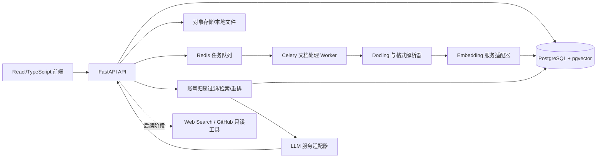
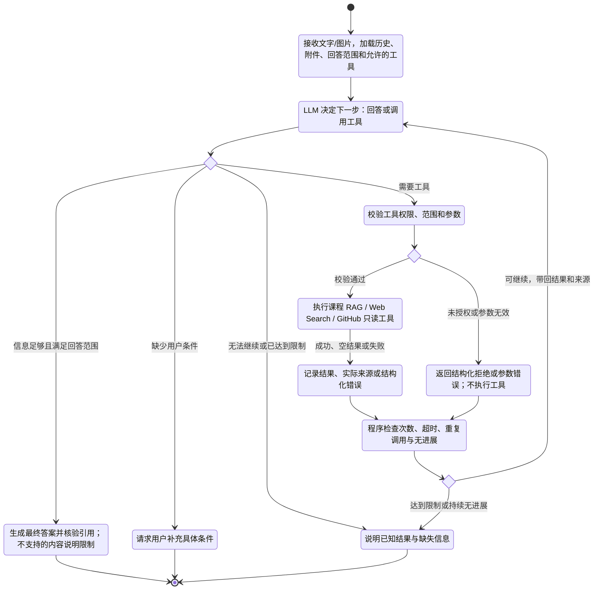

# 智能学习助手：技术实现指引

> 文档用途：作为 Codex 分阶段构建本项目的执行依据。更新时间：2026-10-26。
>
> 当前状态（2026-10-26）：阶段0～2基础能力已交付；阶段3已完成工程与有界实验，生产仍为dense/512维/pgvector。阶段4图文与思考模式、阶段5外部工具及默认自动工具、图片答案核验已交付，历史失败和适用范围按各报告保留。注册、课程对话界面与0007迁移已实现。阶段6完整容器部署、隔离备份恢复、本机回归和真实GitHub CI已通过，公开仓库已创建并推送；匿名干净克隆的完整部署及真实入库/问答/引用验证也已通过，阶段6于2026-10-26完成本轮交付。进度统一见第8节及 docs/stage6/report.md。

## 1. 项目目标与边界

构建面向学生的个人学习助手。每位学生使用自己的账号，按课程整理并上传课件、笔记、试卷、作业习题、教材和参考资料；系统仅检索该账号自己的资料，生成带有可点击来源的回答。首版不设置教师/学生两种角色，不引入课程成员、资料共享或教师审核。后续扩展联网搜索和 GitHub 仓库只读分析。

**首个可交付版本必须具备：**

- 账号、个人课程和资料的基本管理；PDF/DOCX/PPTX/TXT/Markdown 上传和异步处理。
- 按个人课程及所选资料提问；回答附文档名、页码或幻灯片编号、原文片段。
- 找不到足够证据时明确说明，避免编造出处。
- 上传进度、失败原因、重新处理、资料删除及索引清理；所有读写操作按账号隔离。
- 可复现的本地启动步骤和基础评测样例。

**暂不纳入首版：** 自动批改、个性化学习路径、复杂多智能体、联网搜索、GitHub 私有仓库访问、全量多模态理解。这些能力放在后续阶段，不能妨碍核心问答上线。

**阶段 4 调整（2026-10-21）：** 在已有文字资料问答基础上增加图片输入与统一学习问答。资料上传端和聊天端均支持图片；用户直接用自然语言提出概念解释、题目讲解、错因分析或提示要求，无须选择固定学习模式。本阶段范围为文字与图片输入、文字与数学公式输出；音频、视频、图片生成和完整练习系统延后。核心价值仍是结合个人课程资料，提供可核对的学习帮助。以下阶段 4 内容为实施依据；当前已完成工程与本轮有限样本验收，结果及限制见第8节和 `docs/stage4/report.md`。

## 2. 总体架构



### 2.1 固定技术选择

| 领域               | 建议技术                                                                                                              | 用途和实施原则                                                                                                                                                         |
| ------------------ | --------------------------------------------------------------------------------------------------------------------- | ---------------------------------------------------------------------------------------------------------------------------------------------------------------------- |
| 前端               | React、TypeScript、Vite；需要服务端渲染时再考虑 Next.js                                                               | 页面、文件上传、流式回答、来源跳转；首版避免额外服务端复杂度。                                                                                                         |
| 后端               | Python 3.11+、FastAPI、Pydantic、SQLAlchemy 2、Alembic                                                                | API、校验、业务逻辑、数据库迁移。依赖使用锁文件固定版本。                                                                                                              |
| 业务库及首版向量库 | PostgreSQL、pgvector                                                                                                  | 用户、课程、文档、片段、会话及向量；减少首版服务数量。                                                                                                                 |
| 文件存储           | 本地文件适配器用于开发；MinIO 适配器用于部署                                                                          | 保留原文件，数据库只存元数据与对象键。                                                                                                                                 |
| 异步处理           | Redis、Celery                                                                                                         | PDF/OCR/切块/Embedding 等耗时任务，支持重试与任务状态。                                                                                                                |
| 文档处理           | pypdf、python-docx、python-pptx；扫描 PDF 用 pypdfium2 + RapidOCR                                                     | 阶段 1 先支持文本与基础扫描件；复杂版面可在质量评测后引入 Docling。                                                                                                    |
| Embedding          | 生产使用 FastEmbed 的 `BAAI/bge-small-zh-v1.5`（512 维）；阶段 3 已完成独立环境的 BGE-M3 1024维真实对照，未切换生产 | 记录模型名和固定版本；不同模型/维度使用独立索引。BGE-M3的CPU延迟与内存代价保留，生产迁移需另作决定。                                                                   |
| 重排               | 阶段 3 评测可替换的 reranker                                                                                          | 对召回候选重新排序；只在评测证明有效时默认启用。                                                                                                                       |
| 生成模型           | 一个支持流式输出的 LLM API，封装统一接口；阶段 4 优先复用 DeepSeek Flash 的图文输入能力                               | 密钥只放服务端环境变量；不要在业务代码中绑定供应商。图文内容块须通过适配器传递；实际配置的模型名、服务地址及中转接口须先用真实图片验证，不以文字调用成功代替视觉验收。 |
| 测试与运行         | pytest、Docker Compose、GitHub Actions                                                                                | 核心逻辑、API、迁移和最小端到端冒烟测试。                                                                                                                              |

**检索存储演进：** 首版使用 pgvector。中文关键词检索不得直接假定 PostgreSQL 默认英文全文检索效果良好；先建立可复现的中文分词/关键词基线（例如分词后写入 `tsvector`，或应用侧 BM25），用评测集比较。若过滤、稀疏检索或规模成为明确瓶颈，再实现 `VectorStore` 接口的 Qdrant 版本，并通过迁移脚本与评测决定是否切换。Qdrant 支持稠密与稀疏检索融合；不要在未测量时同时维护两套生产索引。

**编排原则：** 已有 RAG 检索服务继续采用可测试的 Python 服务函数；阶段 4 在外层引入 LangGraph 单 Agent 状态循环，将检索封装成工具，阶段 5 在同一循环注册 Web Search 与 GitHub 只读工具。首轮模型可直接回答或发起工具调用，无须额外路由模型。不引入多 Agent、独立 LangGraph Server 或新的向量数据库；业务层继续使用内部数据类型。

## 3. 核心数据流与数据模型

### 3.1 入库流程

`上传文件 → 类型/大小校验 → 保存原文件和哈希 → 创建处理任务 → 文档解析/OCR → 清理噪声 → 保留章节和页码的切块 → 生成向量 → 写入索引 → 标记可用`

- 每个切块至少保存：`chunk_id`、`document_id`、`course_id`、`owner_id`、`text`、`section_path`、`page_start`、`page_end`、`slide_no`、`chunk_index`、`content_hash`、`embedding_model`、`parser_version`。`owner_id` 与所属文档、课程的账号归属保持一致，用于检索前过滤。
- 按标题/章节优先切分，超长段落再按 token 切分；不要跨试题与答案边界合并。切块长度和重叠量做成配置，依据评测调整。
- 试卷和作业习题可用 `content_type` 标记题目、答案、解析，保留已有分类能力。阶段 4 不要求完整分区、提交作答及判分流程；用户可自然语言要求“先给提示，不要答案”。如后续建设完整练习系统，再实现题目/答案/解析分区与按作答状态控制展示，并进行独立验收；不设置教师授权。
- 相同文件哈希可提示重复；文档更新使用新版本和幂等任务。失败任务保留错误信息并可重试；删除文档需同步删除向量和原文件。
- 扫描 PDF 的 OCR 与表格提取只在必要时启用，避免所有文件都承担高开销。记录解析质量异常，允许重新解析。
- 阶段 4 图片资料沿用异步任务：校验实际图片格式、文件大小及解码后像素规模，保存私有原图和哈希，提取文字、公式及必要的图形描述，切块后接入现有文字向量检索。派生内容记录原图关联、解析模型/版本及处理状态；引用可打开原图，定位信息只能使用实际保存的位置。删除时清理派生片段、索引及无其他有效引用的文件。
- 图片文字转写和描述可能遗漏视觉信息，不能宣称覆盖全部图形检索问题。必要时对召回的相关原图进行视觉核对；本阶段不要求更换向量库或引入视觉向量索引，不自动重建旧资料。

### 3.2 问答流程

`鉴权 → 确定当前账号的课程/资料范围 → 查询规范化 → 账号归属过滤 → 召回 → 去重/重排 → 证据阈值判断 → 生成回答 → 核验引用 → 返回答案与证据`

- 每个课程和文档均归属一个账号。课程、文档、处理任务、会话、消息、引用及原文件的读取和修改都必须校验当前账号归属；向量检索在召回前限定该账号及其课程/资料范围，不能只在答案展示时过滤。账号 A 即使知道账号 B 的资源 ID，也不能访问或删除 B 的资料。
- 首版先实现稠密检索 Top-K 与稳定的引用；下一阶段增加中文关键词检索和 RRF 融合，再加入重排。
- 引用由服务端根据实际检索片段生成，不接受模型虚构的文档名或页码。答案和每条引用保存对应 `chunk_id`。
- 无相关证据、证据冲突、来源不可信时，答复应说明范围和不确定性。外部网页结果必须与课程内部资料明确区分。
- 聊天历史用于理解追问，但检索查询需显式记录，避免历史内容越权影响当前资料范围。
- 阶段 4 问答扩展为：鉴权及范围校验 → 加载当前文字/图片、有界历史与允许的工具 → LLM 选择回答、澄清或工具调用 → 服务端校验并执行工具 → 保存结果与来源并返回 LLM → 回答及引用核验或说明限制后结束。课程检索不再是全部请求的强制前置步骤；阶段 4 工具集仅含课程 RAG，阶段 5 增加获授权的 Web Search 和 GitHub。附件读取、模型发送、引用、删除及历史恢复均校验归属。完整循环见阶段 4 的 UML 状态图。
- 用户要求“严格根据课程资料”时，保留证据不足说明或拒答；用户上传题目要求讲解时，允许依据图片条件和通用知识推导，相关课程资料作为补充依据。未限定范围时优先课程资料，并说明必要的通用知识补充。没有检索证据不能一律阻止图片讲题；也不能把缺证据自动解释为允许联网。
- 回答区分图片中识别的条件、课程资料支持的事实与模型推导；课程引用仅支持其实际涵盖的内容，不把知识点来源冒充为完整解答依据。关键符号模糊、题目缺失或图形条件不明时提出具体澄清，不补造条件。错因分析须有用户作答，仅有题目时先讲题或请求补充解题过程。

### 3.3 最小业务实体

`User`、`Course`、`Document`、`DocumentVersion`、`IngestionJob`、`Chunk`、`ChatSession`、`Message`、`Citation`、`EvaluationCase`。`Course` 和 `Document` 记录所属用户；资料只能归入该用户自己的课程。各实体包含创建/更新时间；文档包含状态、哈希、资料类型及原文件键；任务包含阶段、进度、失败原因。首版不需要 `CourseMembership`、用户角色或可见范围字段。数据库迁移由 Alembic 管理。

阶段 4 增加附件与消息的关联，可采用独立附件实体；至少保存附件 ID、账号/会话归属、原文件键、实际格式、大小、尺寸、处理状态和派生内容版本。聊天附件默认只服务所在对话，不进入课程索引；用户明确选择“保存到课程资料”后才通过入库流程创建资料。定义附件保留、消息/会话删除及共享底层文件的清理规则，避免误删仍有效的引用。阶段 4 不建设错误反馈入口、反馈记录或复查列表。

阶段4思考增补在Message保存可空thinking、实际call_config、reply_to_id及私有protocol_state；旧消息不回填。配置与推理/工具协议不返回前端，只公开thinking与对应消息关系，删除随消息/会话清理。

### 3.4 建议 API 契约

| 方法与路径                                           | 功能                                                                     |
| ---------------------------------------------------- | ------------------------------------------------------------------------ |
| `POST /api/v1/auth/login`、`GET /api/v1/me`      | 登录与当前用户；首版可用多个演示账号验证隔离，但不可将身份写死在接口中。 |
| `GET/POST /api/v1/courses`                         | 当前账号的个人课程列表与创建。                                           |
| `POST /api/v1/courses/{course_id}/documents`       | 校验课程归属后上传资料，返回 `document_id` 与 `job_id`。             |
| `GET /api/v1/documents/{document_id}`              | 校验归属后返回文档元数据与处理状态。                                     |
| `DELETE /api/v1/documents/{document_id}`           | 校验归属后删除资料，并清理原文件、片段与索引。                           |
| `POST /api/v1/documents/{document_id}/retry`       | 校验归属后重新处理失败任务。                                             |
| `POST /api/v1/chat/sessions`                       | 在当前账号的个人课程内建立会话。                                         |
| `POST /api/v1/chat/sessions/{session_id}/messages` | 校验会话归属后提问；支持 SSE 流式事件与最终引用列表。                    |
| `GET /api/v1/citations/{citation_id}`              | 校验当前账号归属后返回来源片段及文档定位信息。                           |
| `GET /api/v1/health`                               | 健康检查。                                                               |

API 响应定义统一错误码、分页、请求 ID；OpenAPI 文档随代码自动生成。SSE 事件至少区分 `answer_delta`、`citation`、`done`、`error`，前端不得仅靠解析回答文本猜出处。

阶段 4 扩展契约：提供会话图片附件上传/读取/移除入口，消息请求兼容原 `content` 并增加附件 ID；支持纯文字、文字加图片及仅图片请求，仅图片且意图不明时请求澄清。客户端不直接指定任意服务器文件路径。消息读取返回授权后的附件元数据，支持历史图片恢复和有界多轮引用；资料上传接口扩展图片格式，沿用任务状态、重试和删除契约。图片引用提供归属校验接口，具体路径随实现写入 OpenAPI。

阶段4思考增补：消息请求增加可选严格布尔thinking，缺省false；历史返回nullable thinking，NULL表示旧版本未记录。增加按账号/会话校验的 `POST /api/v1/chat/sessions/{session_id}/cancel`；保留原SSE事件，来源核对结束后才发送最终内容。

## 4. 分阶段实施任务

### 阶段 0：工程骨架与本地环境

**任务**

- 建立 `backend/`、`frontend/`、`infra/`、`tests/`、`docs/`，加入 `.env.example`、`.gitignore`、README、依赖锁文件。
- Docker Compose 启动 PostgreSQL（含 pgvector）与 Redis；后端和前端支持本地开发。文件存储先用本地目录适配器。
- FastAPI 健康接口、配置读取、数据库连接、Alembic 初始迁移；前端基础布局和 API 客户端。
- 配置格式化、静态检查、基本 CI；提交不得包含真实密钥或教材原件。

**验收：** 新环境按 README 可启动；健康接口正常；数据库迁移和基础检查通过。

### 阶段 1：资料入库与课程管理（首版的一半）

**任务**

- 实现账号、个人课程、文档归属与账号隔离；学生可上传并查看自己的课件、笔记、试卷、作业习题、教材和参考资料，不设置教师/学生角色或课程成员关系。
- 上传接口支持 PDF、DOCX、PPTX、TXT、Markdown；校验文件类型、大小、扩展名与内容，设置单文件上限。
- Celery 任务执行解析、结构化切块、Embedding 和索引写入；实现状态、重试与幂等。删除资料时同步清理其片段、向量索引和原文件，并防止仍在运行的入库任务把已删除资料重新写入索引。
- 前端完成课程列表、资料列表、上传进度、错误详情与重试入口。
- 保存章节、页码、幻灯片编号；挑选包含扫描页、双栏、表格和试题答案的样本人工核查解析结果。

**验收：** 学生上传各类资料后可看到任务状态；成功文档可检索到片段；失败可重试；账号 A 无法读取、检索、重试或删除账号 B 的资料；删除后任何账号均无法检索到旧片段，原文件也不可访问。

### 阶段 2：带引用的问答 MVP

**任务**

- 实现查询 Embedding、账号及个人课程/资料过滤、pgvector Top-K 召回、上下文组装、LLM 生成和 SSE 流式输出。
- 返回可点击引用，并打开文档对应页/幻灯片或显示片段；实现低证据回答与错误处理。
- 会话与消息持久化；记录检索片段 ID、模型、耗时和 token/费用估计。
- 前端实现聊天界面、来源卡片、引用跳转和资料范围选择。

**验收：** 用至少 20 个覆盖教材、课件、笔记、试卷和作业习题的真实问题演示；回答出处可追溯；无资料、跨账号或越过所选课程/资料范围的问题不会返回范围外内容。

### 阶段 3：检索质量与可量化评测

**任务**

- 建立至少 50 个标注问题，覆盖中文同义表达、术语精确匹配、跨章节、试题、无答案和跨账号隔离边界；保存期望文档/片段与参考答案。
- 比较稠密检索、中文关键词检索、RRF 混合检索、增加重排后的结果；调节切块和 Top-K。
- 统计 Recall@K、MRR/命中率、引用正确率、无答案拒答率、响应延迟和模型成本。人工抽查答案事实性；自动评测只作辅助。
- 对图表、公式和扫描件质量单独记录错误，不用通用分数掩盖解析问题。
- 仅当 pgvector 方案达到明确瓶颈时，再通过存储接口试点 Qdrant，并比较迁移成本和实际收益。

**验收：** `docs/evaluation.md` 给出数据集构成、运行方法、基线与改进对照表；默认方案有可复现的选择依据。

### 阶段 4：多模态输入与统一学习问答

**实施状态（2026-10-21）：** 工程及本轮有限样本验收完成。117项后端测试、真实DeepSeek图文/工具组合、图片异步入库及浏览器关键路径通过；采用自动化与AI辅助评审，不要求用户人工审核。原始10/11评分中的1条为手写图预期误标，原分数保留并单列更正，不能外推总体质量。报告见[阶段4实施与验收](docs/stage4/report.md)。

**目标与范围**

- 资料上传端和聊天端均支持图片，首批格式为 JPEG、PNG、WebP；支持文字与图片输入，输出文字、来源及数学公式。现有文档格式和文字问答保持兼容。
- 统一聊天入口承接“解释概念”“讲解这道题”“分析我的错误”“先给提示”等自然语言要求，取消强制选择三种模式和固定输出格式，不要求用户学习专用指令。权限、证据判断、引用校验和附件状态由程序保证。
- 延后完整练习系统：题库、题目/答案/解析完整分区、作答提交、判分、练习进度、答案解锁及系统化出题去重均不作为本阶段交付。自然语言临时生成练习可作为一般问答请求，但不承诺题库级质量或提交前隐藏答案。音频、视频、图片生成与全量视觉检索另行规划。

**Agent 流程 UML 状态图（Mermaid）**

下图描述阶段 4～5 的目标流程；阶段 4 只启用课程 RAG，阶段 5 再注册外部工具。同一 LLM 在工具结果返回后继续决策，不需要两个模型或多个 Agent。澄清与说明限制均结束本轮请求，用户回复后以新一轮恢复上下文。



模型决定行动建议，服务端决定权限和终止。严格课程问答须有实际课程证据，图片讲题须有完整关键条件；引用关联由程序核验，不能只依赖模型自称“信息足够”。工具可以跨轮组合；阶段 5 可先读仓库再检索课件，而非一次请求永久选择单一路线。

**任务与实施顺序**

1. **聊天图片闭环：** 实现上传、粘贴、预览、移除及附件持久化，支持同条消息的文字和图片；以真实题目验证 DeepSeek Flash 当前端点的图文与流式调用，再接入统一模型适配器。构建有界历史和图片上下文，支持“第二步为什么这样做”等追问；前端安全渲染 Markdown 与数学公式。
2. **Agent 循环与工具协议：** 使用 LangGraph 管理状态、模型节点、工具执行节点和条件分支，将现有检索封装为 `search_course_materials`。扩展模型适配器以处理工具定义、流式参数、调用 ID、工具结果及图文消息；用实际端点验证图文与工具组合。完整收齐并校验参数后才执行，保留原文字消息与 SSE 兼容性。
3. **状态、权限与终止：** 保存当前请求、附件、有界历史、回答范围、允许工具、调用结果、来源 ID、执行次数与停止原因；账号和课程范围由服务端注入，模型不可自行扩大。工具空结果、失败及拒绝执行作为结构化结果回传，可改写查询或选择其他已授权工具。设置有界执行次数、单次超时、重复调用与无新增信息检测；无法继续时说明限制并结束，缺少条件时向用户澄清。不新增反馈、配额、费用管理或独立资源控制模块；这些终止条件只是循环正常运行的基本要求。
4. **回答边界与来源：** 按第 3.2 节“问答流程”执行严格资料问答、图片讲题及通用知识补充规则；基于识别出的题意构造检索查询，避免直接用“讲解这道题”检索。保留实际检索查询、选用来源及生成模型记录；图片内容同资料正文一样视为不可信数据，不能改变权限或系统规则。 核验实际来源 ID 与引用，区分图片条件、课程事实和推导；核验失败时去除不受支持的引用或说明限制，不无限循环修复。
5. **图片资料入库：** 按第 3.1 节“入库流程”保存原图、提取内容并接入现有文字检索，支持处理进度、失败原因、重试、原图引用和删除。聊天附件默认不入库；明确保存到课程资料后才建立索引。复用个人课程、资料类型筛选与账号隔离。
6. **自动化评测与回归：** 冻结包含文字截图、公式、表格、简单图形、手写、模糊及缺条件图片的样本，分开统计关键条件识别、解答正确性、来源支持、澄清行为、延迟与成本。由执行代理完成自动化检查与 AI 辅助评审，不要求用户逐题人工审核或签署验收。可确定的文字、数值、公式及引用关联优先与固定预期结果进行程序核对，开放性讲解使用 AI 辅助评审并明确标注身份与不确定项，保留失败和评审异常，不冒称人工独立审核；不以“接口有回答”或单个成功例子宣布通过，不将复杂手写/几何题列为无条件准确承诺。

**验收**

- 两个入口均有真实端到端演示：聊天图片可讲题；图片资料处理就绪后可通过文字问题检索，并打开正确原图核对。
- 不选模式即可解释概念、讲题、按明确要求先给提示；上传题目和错误作答后能定位错误步骤，未提供作答时不编造用户错因。
- 公式、表格及简单图形样本有自动化检查结果与 AI 辅助评审记录；模糊、缺条件及关键符号不明的样本指出具体问题。保留冻结样本的逐项结果和失败记录，识别错误与推理错误分别统计；不要求用户人工审核，AI 评审不作为独立真人验收或整体准确率保证。
- 图片及消息刷新后可恢复，连续追问能关联正确图片；上传/识别失败可理解、可重试。沿用现有基础上传校验及必要的接口兼容限制，不新增独立的资源预算、配额或费用监控功能。
- 严格资料问答仍遵守证据限制；图片讲题不因课程无证据而无条件拒答；课程事实、图片条件和推导来源清楚，无虚构引用或页码。
- 跨账号附件/原图访问被拒绝，跨课程检索受限；临时附件不会自动入库，明确保存后可检索，删除按关联规则清理且不误删其他有效资源。
- 原有文字上传、异步入库、检索、引用、历史和 SSE 错误处理通过相应回归检查。
- 自动化覆盖直接回答、调用 RAG、空结果改写查询、缺条件澄清、工具失败、越权参数、重复调用和达到上限等路径；记录实际工具选择及停止原因。严格资料请求不会绕过证据约束，图片讲题不强制先检索。

### 阶段 4 增补：用户可选思考模式

**实施状态（2026-10-22）：** 工程、必需真实协议及浏览器验收完成；下列任务为已实现要求。普通模式质量对照仍有1道组合题错误，原失败不覆盖；配置、逐项证据、限制及复现见[独立增补报告](docs/stage4_thinking/report.md)。

**需求确认记录（2026-10-21）：** 本增补在已完成的阶段4基础上新增，独立实施与验证，不能沿用原117项或原非思考模式结果宣称通过；原阶段4交付与验收记录继续保留。当前完成情况见上方状态及第8节。

**目标与范围**

在聊天输入框附近增加两状态的“深度思考”开关，由用户决定本条问题是否启用。开启表示愿意等待更充分的推导，不承诺答案必然正确，也不要求最终答案更长。只控制 Agent 决策与解答，图片资料转写和引用核对采用独立后端参数；继续使用同一 DeepSeek Flash 服务，不引入额外路由模型、多Agent或独立设置页面。

**界面与消息行为**

- 首次使用默认关闭，开启时高亮；提示：“适合复杂推导、错题分析和多步问题，回答可能需要更长时间。”不向用户暴露思考强度、token或超时参数。
- 按当前账号记住最后选择，刷新可恢复；切换账号不会继承其他账号的偏好。每条用户消息及对应回答保存发送时的选择，历史中显示是否启用思考。
- 发送时确定本条消息的开关状态，本轮生成期间禁用切换；同一轮的模型决策、工具返回后的推理及最终解答使用同一组 Agent 参数。下一条消息可切换，不改写历史消息。
- 支持纯文字、图文及仅图片请求。“看图片讲题”跟随开关；“将图片转写并保存为课程资料”固定关闭思考，不能按“是否有图片”一律关闭。
- 思考模式不改变严格资料要求、账号/课程范围、引用规则或工具授权，不启用阶段5工具。保留停止按钮与简短的思考、检索、来源核对进度，不展示完整内部推理或工具参数。

**调用参数初值（本轮真实对照已验证接线，数值未调整）**

| 调用用途                    | 思考模式                       | 生成token上限 | 单次调用超时 |
| --------------------------- | ------------------------------ | ------------- | ------------ |
| Agent决策与解答，用户未开启 | 明确关闭                       | 2048          | 90秒         |
| Agent决策与解答，用户开启   | 明确开启，后端初始采用high强度 | 8192          | 180秒        |
| 图片资料转写                | 固定明确关闭                   | 4096          | 90秒         |
| 引用支持核对                | 第一版固定明确关闭             | 1024          | 60秒         |

上述是可配置的试运行起点，不是质量、响应时间承诺，也不是每次必须用满的额度。生成上限为供应商生成预算，不能等同于用户可见答案长度；超时是调用上限，不是预期等待时间。根据真实截断率、超时和答案对照调整，并记录变更依据；不直接套用供应商最大值。

**任务与实施顺序**

1. **请求级参数与用途分离：** 为模型适配器及 `complete_turn` 增加不可变的请求级调用参数，至少包含思考开关、可选思考强度、生成上限和超时；服务端按 `agent`、`transcription`、`citation_check` 三类用途选择配置。不得修改全局 Settings 或环境变量来响应某个用户的按钮，不使用可被并发请求覆盖的全局可变状态；用途由服务端业务入口确定，不能让客户端伪造用途绕过规则。密钥、地址、模型继续复用原配置。
2. **接口、存储及前端：** 消息请求在兼容content/attachment_ids基础上新增可选布尔 `thinking`，旧客户端不传时使用关闭模式，不能受另一个请求影响。客户端只提交是否开启，不提交任意生成上限、超时或工具权限。将发送时的选择及必要的实际配置快照关联到本轮消息；新增字段提供Alembic迁移，旧消息按“未记录/旧版本”展示，不能伪造历史开关状态。实现输入区按钮、账号偏好隔离、生成时禁用及历史标记。
3. **调用入口接线：** `run_agent` 的所有模型回合使用本条消息的 Agent 参数；`describe_image` 及 Celery 图片入库明确传转写参数并关闭思考，不继承聊天选择；`checked_answer` 明确使用非思考的引用核对参数，开启/关闭思考都不能跳过核验。显式映射 DeepSeek 的thinking.type，不能省略字段后误用供应商默认；思考强度和不适用采样参数按当前官方接口处理。当前共用的LLM配置须拆为调用用途配置，不能只增加前端按钮。
4. **多轮和工具协议：** 按当前官方协议处理 `reasoning_content`、工具调用ID及结果回传，验证本轮多次工具调用，以及后续追问、刷新恢复和跨消息切换开关的兼容性。不能把只保存历史回答正文视为已经完成思考模式适配；也不能未经真实验证就用空推理字段替代协议所需上下文。必要的协议状态仅在服务端按账号隔离管理，不返回前端或写入普通日志；新状态的保存、恢复和删除方式随实现写入文档。
5. **分层超时与可靠终止：** 图片转写、引用核对、Agent调用和课程检索各自设置超时；检索不再借用用户选择的思考超时。整轮聊天采用单调时钟截止时间，初始建议360秒，覆盖模型回合、工具等待、引用核对、重试及退避；每次操作的实际时限不超过该步骤上限及整轮剩余时间，剩余不足时不继续开启新调用。连接超时、流读取超时与总截止时间分别处理，不只把HTTP读取超时翻倍。同步检查pending中断恢复期限，避免将仍合法运行的请求误判为过期。维持原有轮数、去重与无进展停止；截断、超时和取消有明确状态，不泄露半截工具参数、不无限重试、不悄悄切换成非思考模式。
6. **自动化与真实对照：** 由执行代理完成测试、真实供应商验证与AI辅助评审，不要求用户人工审核或签字。先冻结参考答案/评分标准，再使用同一组自制或许可明确的非敏感样本，对照开关两种状态，覆盖简单事实、复杂数学/错因分析、严格资料综合、图文及多轮检索；将开发样本与最终验收样本分开，保留失败和评审异常。分别记录正确性、解释完整性、引用支持、工具选择、截断/超时、完成耗时及可获得的用量；原阶段4样本复用只能称回归，不冒称新保留集，不用输出长度代替质量评分。不增加反馈、配额或费用管理界面。

**验收**

- 浏览器可切换开关；首次关闭、账号偏好记忆、生成时锁定、历史标记和刷新恢复均符合设计。原客户端请求仍可使用，历史旧消息不被误标为已经开启。
- 程序核对实际发往供应商的参数：开启时Agent使用思考配置，关闭时使用普通配置；无论按钮状态，图片资料转写及引用核对都明确关闭思考。同条消息中图片讲题仍可开启思考。
- 并发发送一条开启和一条关闭的请求，模式、生成上限和超时互不串用；不同账号偏好和协议状态隔离。阶段5工具仍不可用，严格资料与越权防护不退化。
- 真实DeepSeek完成开关两种状态的图文问答、工具调用、多次结果回传、追问及跨消息切换测试；不因历史协议状态缺失返回400。断流、生成截断、步骤超时、整轮截止和取消均有自动化覆盖，消息不长期停留pending，最终内容与持久化记录一致。
- 有固定样本的两种模式对照结果及实际配置记录；清楚区分模拟/真实调用、程序/AI评审，不预设开启模式一定更好，也不覆盖原失败或要求用户人工签字。只有真实兼容与关键功能验证完成后，才将本增补标为完成。
- 现有文字/图片上传、异步入库、聊天历史、来源原图、SSE事件及阶段4关键回归通过；更新README、配置示例、技术指引进度和独立增补验收报告，保留原阶段4报告。

**接口参考：** [DeepSeek思考模式及工具上下文要求](https://api-docs.deepseek.com/guides/thinking_mode/)、[Chat Completions参数](https://api-docs.deepseek.com/api/create-chat-completion/)。实施前核对当前官方协议及实际端点，以上配置初值不能替代真实验证。

### 阶段 5：Agent 外部工具扩展（Web Search 与 GitHub 只读）

本节基础工程已交付，实际结果见第8节及 `docs/stage5/report.md`。下方“阶段5补充任务”为用户确认的下一步实施依据；实施后，自动模式取代现有默认关闭、手填公开关键词和手动仓库授权的正常聊天流程，原来源核验与安全约束继续保留。当前运行代码尚未应用该补充规划。

**目标与范围**

沿用阶段 4 的 LangGraph 单 Agent 循环和状态契约，注册外部工具，不另建一套聊天流程。模型可直接回答，或按需要跨轮组合 RAG、Web Search、GitHub；不强制每次都联网。GitHub 本阶段仅读取仓库，修改文件、提交代码、创建 Issue/PR 等写操作另行规划。

**任务与实施顺序**

1. **统一工具注册与授权：** 按用户当前授权生成可用工具集；Web Search 关闭时不提供或执行网页工具，GitHub 仅可访问指定且已授权仓库。服务端再次校验调用参数、账号/课程/仓库范围，不因检索无结果而自行启用联网，也不能把严格课程资料请求转为外部补答。沿用阶段 4 的停止条件与错误协议。
2. **网页搜索与读取：** 接入实际可用搜索 API，分别封装 `web_search` 和 `read_web_page`；搜索结果用于发现来源，需核对事实时读取相应网页内容，不能把摘要冒充全文。记录标题、URL、访问时间及实际读取片段；页面失败、超时或无有效正文时返回明确状态，不伪造检索成功。网页读取限制协议和地址，阻止访问本机、内网与云元数据地址，并对跳转后目标重复校验。
3. **GitHub 只读工具：** 通过 GitHub REST API 或适用的 MCP 接口封装目录、README、代码文件及必要提交信息读取。私有仓库采用最小只读权限，凭证只在服务端保存，不接受任意仓库令牌透传。返回仓库、分支/提交 SHA、文件路径和实际行号；尽量固定本次分析的提交，防止多轮读取不同版本。仓库内容不允许指示 Agent 执行代码或扩大权限。
4. **组合执行与证据汇总：** 支持“读取仓库实现 → 检索课程算法说明 → 回答”等跨工具路径；每次结果记录来源和状态后返回模型，必要时继续调用。图片、课程片段、网页和仓库文本均为不可信内容，不能改变系统权限。最终回答区分课程资料、网页、仓库代码和模型推导，并核验可点击引用；无足够依据则澄清或说明限制。
5. **状态恢复与页面进度：** 复用 PostgreSQL 保存会话及执行记录；需要中断恢复时采用 LangGraph 检查点并绑定账号、会话与请求，避免恢复后串用来源。SSE 可增加工具开始/结束状态，页面展示“正在检索资料/读取网页/读取仓库”等简短进度，保留已有最终答案与错误事件；不展示模型内部推理全文。
6. **自动化评测：** 冻结覆盖工具选择、RAG 与外部来源组合、搜索失败、仓库无权限、内容指令注入、重复调用及正常终止的案例。可确定字段和权限用程序核对，开放性答案由 AI 辅助评审，保留失败与评审异常，不要求用户人工审核或签字。

**验收**

- 关闭 Web Search 时没有网页搜索/读取请求；仓库工具受独立授权限制。关闭外部工具不影响课程 RAG 与直接回答，未授权调用在服务端被拒绝。
- 同一 Agent 可演示直接回答、RAG、网页搜索后读取、指定仓库读取及跨工具组合；无需每个问题调用全部工具。
- GitHub 工具无法写仓库，私有仓库凭证不暴露；引用包含实际读取的提交、文件路径及有效行号，网页引用含实际 URL 和访问时间。
- 工具空结果、失败、超时、无权限及恶意内容均有自动化覆盖；循环能澄清、说明限制或有界结束，不因工具失败无限重试或编造答案。
- 外部引用与课程引用清楚区分，检查点和历史恢复遵守账号及资料范围；原有文字/图片聊天和课程检索通过回归。由执行代理完成自动化与 AI 辅助评审，不要求用户人工审核。

#### 阶段5补充任务：默认自动使用外部工具与简化聊天界面

**实施状态：** 2026-10-23已完成前后端实现、227项后端自动化、格式/构建/锁及临时库迁移检查；完整浏览器14项、真实图文4项通过。最终公开8题完整回答7/8（此前同样本回归8/8），MU工具路线正确但最后到循环上限未形成有效行情答案；私有真实验收待适用凭证。详见[补充报告](docs/stage5_auto_tools/report.md)。原阶段5及本补充失败记录保留，不把实现完成等同所有真实答案通过。

**目标与交互**

用户直接用自然语言提问、粘贴仓库链接或上传图片，默认允许现有单Agent按需调用Web Search和GitHub只读工具。模型自行选择直接回答、课程RAG、外部工具或组合调用；简单问题可以零外部调用，不强制每条消息联网。不增加独立路由模型、第二套聊天流程或多Agent，继续复用当前DeepSeek Flash、LangGraph及已有适配器。

移除输入区“外部来源（按本条消息授权）”整个配置面板，包括联网复选框、公开关键词输入框、仓库/分支输入框和逐条验证授权按钮。**移除的是输入配置面板；回答中的课程、网页和仓库来源引用继续保留，并支持折叠查看。** 保留问题、图片、深度思考、发送、停止及简短工具进度，不展示内部推理或工具参数。只有遇到缺少私有仓库权限等实际阻塞时，才提示必要连接或授权，不恢复每条消息手工配置的流程。

**任务与实施顺序**

1. **默认自动模式与范围约束：** 在服务已配置且具备访问能力时，默认提供可用外部工具，由Agent按任务决定是否执行。未配置时返回明确不可用状态，其他回答路径仍正常。用户明确说“不要联网”时禁止网页搜索/读取；“严格/只根据课程资料”禁止全部外部补答，并按现有规则继承到追问，直到用户明确修改。自动模式不能扩大账号或资料范围。
2. **同步改造前后端契约：** 普通消息不再要求用户填写 `web_queries`、`repository_grant_ids`，不得因缺少这些字段返回原“请填写公开关键词”等错误。服务端根据用户请求、有效上下文和当前权限生成本轮不可变工具策略。内部授权ID可以保留，由服务端自动创建、管理和验证；不能要求用户填写，也不能相信模型自造的ID。定义旧请求字段的兼容/弃用规则，尊重显式关闭；旧消息和旧关闭快照不回填为新授权。仅隐藏面板或修改开关默认值不算完成。
3. **自动搜索词与外发边界：** Agent根据本条问题和理解追问所需的会话意图生成精简查询，可在有界循环中改写和补查；取消查询必须逐字等于用户预填关键词的限制。服务端仍需落实外发边界，不能只依赖提示词；不自动将私人教材、笔记、图片转写、私有代码正文、凭证或完整聊天历史拼入搜索。确需发送私人原文时，再针对具体内容说明并取得授权。记录实际调用状态及必要查询信息，敏感正文、密钥不进普通日志。
4. **仓库链接识别与自动授权：** 用户明确请求读取/分析仓库时，从其消息中的GitHub链接（支持 `.git` 后缀）或当前有效会话目标识别 `owner/repo`，服务端验证并自动建立当前账号/会话内的任务只读范围，无须再次填写仓库、分支或勾选授权。未指定分支时查询默认分支，不硬编码 `main`/`master`；指定分支、tag或提交时尊重选择。解析到实际SHA并固定本次分析版本，按需读取目录、README和代码，引用实际文件及行号。跟进明确目标无需重复配置；多目标或歧义只澄清必要信息。仅在网页、README、图片或工具正文中出现的链接，不能自动成为新的仓库授权。
5. **私有权限与既有安全：** 公开仓库使用任务范围内的匿名只读访问；私有仓库复用当前账号已有且适用于目标仓库的服务端凭证，缺少权限时再提示连接，不让用户把Token发到聊天。内部授权仍绑定账号、会话及请求，支持撤销和历史失权处理。保留路径/行号、链接/子模块、SSRF/跳转及凭证隔离约束；网页读取不能绕过仓库权限。继续禁止仓库写操作和内容指示的代码执行。
6. **引用、历史与循环：** 保留来源登记、权限/定位/内容支持核验，区分课程、网页、仓库和模型推导；网页事实需要实际读取，摘要不能冒充正文。刷新追问重新核验有效范围与来源，不把历史编号当成本轮证据。更新现有手动选择相关的历史策略，避免“未勾选旧仓库即失权”阻断自动模式下的正常追问，同时禁止重放已撤销的私有正文。保留本条思考配置、并发隔离、截止/取消、去重及无进展终止；失败时说明限制。
7. **时效示例与独立交付：** “查询现在MU的股价”等当前信息应触发新来源获取，不用模型记忆冒充最新结果。报价附可核对的币种、行情时间/时区及可确认的交易时段、延迟情况；获取不到则说明缺失。Tavily网页报价不等于交易所级实时行情，未接有时效保证的行情接口时不得声称严格实时，本补充不强制增加行情供应商或购买服务。新增补充进度、冻结案例、原始结果及报告放入 `docs/stage5_auto_tools/`，完成后同步README和本文进度；保留原阶段5失败及真实私有验收未运行的事实。不改dense/512维、不重建旧资料，不扩展阶段6及已取消的反馈/配额/费用界面。

**验收标准**

- 默认自动模式下，用户只发问题即可；不携带手填搜索词或仓库授权ID也能正常处理，不出现原必填错误。缺少搜索配置有明确状态，不阻断课程RAG与直接回答。
- 输入区没有外部来源配置面板；深度思考、图片、停止、进度正常，回答来源仍可点击、可折叠且经过服务端核验。
- 简单问题可直接回答；严格课程请求和明确禁用联网请求不发出受限外部调用，不采用强制所有问题搜索的固定流程。
- 当前信息案例能自动生成查询、搜索、读取并附实际来源与时间；行情测试检查字段和时效，不把动态价格冻结成固定答案，也不冒称严格实时。
- 用户仅提供仓库链接并要求读取时，自动规范化 `.git`、获取默认分支、建立内部授权、固定SHA并读取。指定分支/提交、刷新及同会话追问正常；已有私有权限无需重复配置，缺少权限才提示连接，不串用其他账号凭证。
- 同一Agent能完成“读取仓库 → 检索课程资料 → 分别引用”，无需每次使用全部工具。真实验收使用隔离账号和公开/自制样本；示例仓库若为私有或不可用，明确记录而非伪造成功。
- 自动查询的隐私边界、伪造授权ID、跨账号/课程/会话、撤销、提示注入、SSRF、失败/空结果/超时、重复/无进展、并发配置及取消均有自动化覆盖。
- 完成适用后端回归、前端类型/构建、必要迁移兼容及普通/思考模式真实工具协议、浏览器自然语言提问和刷新追问验收。程序核对与AI辅助评审分别报告，不沿用原阶段5分数宣称补充任务通过，不要求用户人工审核；失败、未运行和供应商限制如实保留。

### 阶段 6：本地可复现部署与 GitHub 项目交付

**目标与范围**

面向个人学习、求职和公开代码仓库，完成可克隆、可本地部署、数据可恢复、测试可运行、文档可查阅的项目交付。本阶段不要求系统通过公网持续提供服务，不租用云服务器，不配置域名或 HTTPS，不建设面向外部试用的告警、费用监控、限流或新增访问控制模块；已有鉴权、账号隔离和上传安全校验继续保留。

**任务**

1. **仓库整理与版本管理：** 初始化 Git，核对 `.gitignore` 和实际待提交文件，保留源码、依赖锁文件、配置模板、必要测试及可公开文档。排除真实 `.env`、私人教材、数据库备份、模型缓存、虚拟环境、运行产物及包含私人原文或凭证的评测材料；历史报告按是否可公开逐项检查，保留可公开的结论和复现说明。完成检查后推送 GitHub，并提供可供他人访问的公开仓库，记录首个可复现版本。
2. **完整本地部署：** 在现有 PostgreSQL、Redis 配置基础上，补齐前端构建与静态资源服务、FastAPI API、Celery Worker 的 Dockerfile 和 Docker Compose 配置；明确服务依赖、健康检查、数据库迁移和初始化步骤。保留现有开发启动方式；提供配置模板及模型密钥填写说明，明确首次模型下载、缓存目录和外部服务依赖。构建过程不得打包真实密钥或私人资料，API 与 Worker 使用一致的配置和共享资料目录。
3. **持久化与备份恢复：** 继续使用现有本地文件存储适配器，本阶段不强制引入 MinIO 或其他对象存储。为 PostgreSQL、原文件及需要保留的运行数据配置明确的持久化路径；说明停机、重启、更新与数据清理命令的影响。提供数据库与原文件的一致性备份、恢复步骤，并在独立数据库和目录中实际验证恢复，不覆盖现有学习资料。
4. **关键测试、CI 与基础排错：** 整合已有后端测试、前端类型检查和构建，以及注册登录、上传入库、问答与引用、文档删除、账号隔离、越权检索、幂等处理和失败重试的关键回归；完成本地部署环境的端到端冒烟。复用并完善已有 GitHub Actions 配置，首次推送后检查真实 CI 结果并处理环境差异。普通 CI 使用自制样本和可控模型响应，真实模型或外部服务验收单独手动触发，结果区分记录。补齐必要的结构化请求、任务、耗时与错误日志及请求/任务关联标识，用于本地排查，避免记录密钥和私人正文。
5. **README 与技术文档整理：** 将根目录 README 整理为项目入口，包含项目用途、已实现功能、实际技术栈与架构图、必要界面截图、快速启动、配置、测试、备份恢复及已知限制。详细阶段记录和实验报告保留在 `docs/`，通过清晰链接导航。引用已有真实评测结果时说明数据集、样本量、运行条件及限制，区分默认方案与实验方案，不将局部实验成绩表述为整体质量或生产容量保证。

**建议顺序：** 仓库整理 → 完整本地部署 → 持久化与恢复 → 关键测试和 CI → README 与技术文档整理 → 公开 GitHub 仓库。

**验收**

- 从干净的代码副本出发，按 README 安装必要工具、填写自有服务配置后，可以构建并启动前端、API、Worker、PostgreSQL 和 Redis，完成注册、创建课程、上传处理、问答及查看来源的关键流程；缺失可选服务时明确说明功能限制。
- 重启服务后账号、课程、资料、会话和引用仍可用；在隔离环境完成数据库及原文件恢复，核对资料读取、检索和引用正常，现有用户数据未被覆盖。
- 适用后端回归、前端类型检查和构建、部署环境冒烟通过，GitHub Actions 有可查阅的实际运行结果；真实服务验证的成功、失败和未运行情况如实记录，不以模拟结果代替真实模型质量结论。
- GitHub 仓库可被他人访问和克隆，包含完整的必要源码、锁文件、配置模板和文档，不含真实密钥、私人资料、模型权重和本机环境；README 链接有效，功能与评测描述符合当前实现。

## 5. 工程约束与质量要求

- **账号隔离：** 在数据库查询、向量检索和原文件访问前绑定当前账号，并校验课程、资料及派生资源的归属。前端隐藏按钮不算访问控制。为跨账号读取/修改、跨个人课程检索、已删除文档和进行中的入库任务编写测试。
- **数据与密钥：** 上传文件默认私有；限制 MIME/大小与路径；服务端保管模型和 GitHub 凭证；日志避免记录完整教材、私人笔记和令牌。
- **可替换接口：** `DocumentParser`、`EmbeddingProvider`、`VectorStore`、`Reranker`、`LLMProvider`、`ExternalTool` 使用清晰的协议/接口；业务层依赖内部 `Document`、`Chunk`、`Evidence` 数据类型。
- **可观测性：** 每次问答记录查询、过滤范围、候选片段 ID、最终引用、各阶段耗时及模型版本；敏感正文默认不进日志。
- **版本管理：** 解析器、切块策略、Embedding 版本变化时提供重建索引路径；避免新旧向量混用。
- **验收方式：** 每阶段先完成可运行的纵向功能，再补必要测试与文档。不能只搭空目录或接口桩就宣称阶段完成。

## 6. 建议目录结构

```text
StudyRAGAgent/
├─ backend/
│  ├─ app/
│  │  ├─ api/             # 路由与请求/响应模型
│  │  ├─ core/            # 配置、鉴权、错误处理
│  │  ├─ db/              # ORM、迁移、仓储
│  │  ├─ domain/          # 内部实体和服务接口
│  │  ├─ ingestion/       # 解析、切块、任务
│  │  ├─ retrieval/       # 召回、融合、重排
│  │  ├─ generation/      # 提示、答案、引用
│  │  ├─ providers/       # 模型、存储、外部工具适配器
│  │  └─ workers/         # Celery 入口
│  └─ tests/
├─ frontend/
├─ infra/
├─ docs/
├─ evaluation/           # 可公开的样本、脚本与结果
├─ docker-compose.yml
├─ .env.example
└─ README.md
```

## 7. 交给 Codex 的执行方式

按阶段逐次提交任务。每次任务应明确：当前阶段、要做的纵向功能、验收条件、允许改动的目录。Codex 在动手前读取本文件与已有代码；发现实现与文档不符时先依据现状给出调整理由，再修改。每阶段结束需汇报：完成项、关键设计、运行/测试结果、未解决问题和下一阶段入口，并同步更新本文进度。

**后续验收入口：** 默认自动工具与简化界面已实现，见 docs/stage5_auto_tools/report.md。后续保留冻结样本与原始失败，针对动态行情在有界工具循环内的稳定性扩充验证；真实私有仓库仅在当前账号已配置适用的只读凭证并明确授权后验收。不得把既往8/8覆盖最新7/8，不扩大Token权限或新增付费服务，不改dense/512或重建用户资料。阶段6已于2026-10-26完成本轮交付，验收与限制见 docs/stage6/report.md。

## 8. 阶段进度

| 阶段                             | 状态                                                                                                                                                                                                                                                                               |
| -------------------------------- | ---------------------------------------------------------------------------------------------------------------------------------------------------------------------------------------------------------------------------------------------------------------------------------- |
| 0 工程骨架                       | 已完成（2026-10-14；本机 Docker Compose、迁移与健康接口实测通过）                                                                                                                                                                                                                  |
| 1 资料入库                       | 已完成基础验收（2026-10-15；纯扫描 PDF 已用自制样本验证，复杂版面与扫描件准确率留作专项质量评测）                                                                                                                                                                                  |
| 2 问答 MVP                       | 当前 DeepSeek Flash 路径已通过迁移、15 项后端测试、20/20 真实来源检查及主要浏览器问答流程；文件预览内容与异常重试的浏览器核验仍待补充（2026-10-16）                                                                                                                                |
| 3 质量评测                       | 工程实现和有限试点评测完成（2026-10-20，按用户确认收尾）。已交付检索/评测、真实模型及隔离索引实验、跨表程序核对；最新90项后端测试通过。审核身份及原失败按各轮留档；不代表全课程推广或独立真人验收。生产保留dense/512维，新表格核对开关默认关闭                                     |
| 4 多模态输入与统一学习问答       | **已完成工程及本轮有限样本验收（2026-10-21）**；117项后端回归、迁移与前端检查、真实DeepSeek/异步入库及浏览器流程通过；隔离资源已清理。采用AI辅助评审，标注错误原记录保留；基础交付保留；思考模式增补见下行独立验收，复杂视觉和生产推广另行验证。[报告](docs/stage4/report.md) |
| 4增补 用户可选思考模式           | 已完成工程与必需功能/真实协议验收（2026-10-22）：本次148项后端测试、迁移/前端构建、真实DeepSeek工具与跨消息开关、2条真实Chrome流程通过；16项最终真实链路检查通过。质量对照普通5/6、思考6/6，普通模式组合题错误保留；见独立增补报告，不宣称所有模型答案正确                         |
| 5 外部工具                       | 2026-10-23已交付工程、自动化及有界公开链路验收；Tavily/网页/GitHub只读接入同一Agent。修复后6题回归5题完整通过，复杂网页思考1题失败保留；真实私有仓库验收待凭证。见 docs/stage5/report.md                                                                                           |
| 5增补 默认自动工具与简化聊天界面 | 2026-10-23实现与工程检查完成；227项后端测试、前端/锁/临时迁移、浏览器14项及真实图文4项通过。最终冻结公开7/8完整回答；MU到轮次上限，无有效行情答案；真实私有待凭证。见 [独立报告](docs/stage5_auto_tools/report.md)。                                                                |
| 6 部署展示                       | 2026-10-26完成：完整容器部署、隔离备份恢复、276项后端/29项浏览器、真实CI及匿名干净克隆通过；public仓库与v0.1.0已交付。见 docs/stage6/report.md                                                                                                                                                                                                                                                                             |

### 阶段 0 实施记录

- 前端采用 React 19、TypeScript 5、Vite 6；后端采用 FastAPI、Pydantic Settings、SQLAlchemy 2、Alembic。依赖由 `frontend/package-lock.json` 和 `backend/uv.lock` 锁定。
- Compose 使用 pgvector PostgreSQL 16 和 Redis 7；初始迁移启用 `vector` 扩展，业务表留待阶段 1 按实体需求设计。原文件先由本地目录适配器保存。
- 健康接口实际检查 PostgreSQL 和 Redis 连接。README 记载启动、迁移和检查命令；GitHub Actions 执行基础检查。
- 2026-10-14 在本机安装 Docker Desktop 4.95.0 后，Compose 中 PostgreSQL 与 Redis 均通过健康检查；在线迁移到 `0001_initial`，确认 `vector` 扩展存在，`GET /api/v1/health` 返回 HTTP 200。
- 前端联通验收发现 `localhost` 与 `127.0.0.1` 混用导致浏览器请求失败；统一开发地址后，实测前端所用 API 地址正确，后端对前端来源返回允许跨域头，健康接口返回 HTTP 200。

### 阶段 1 实施记录

- 实现两个本地演示账号的登录、个人课程、资料上传与列表、任务状态与重试、原文件访问、按账号过滤的片段查看和向量检索；服务端对课程、资料、任务、原文件和索引查询校验账号归属。未引入教师/学生角色或课程成员关系。
- 使用 Celery/Redis 异步解析与索引；支持 PDF、DOCX、PPTX、TXT、Markdown，保留可提取的页码、幻灯片编号和章节信息。删除时先使资料退出可见及检索范围，再清理文件、片段与向量；运行中的旧任务无法把资料重新写入。
- 原计划的 BGE-M3 体积较大。为在本地完整验证真实入库，阶段 1 改用 FastEmbed `BAAI/bge-small-zh-v1.5`（512 维）；模型名写入片段。未来切换 BGE-M3 等模型时需要迁移向量维度并重建索引。
- 2026-10-15：Alembic 迁移到 `0002_stage1`；后端 8 项测试通过，Ruff 检查与格式检查通过，前端类型检查和生产构建通过。真实 Celery + 模型 + pgvector 冒烟流程验证了上传、检索、跨账号隔离及删除后无旧片段；浏览器核查了登录和创建课程的前端流程。
- 2026-10-15：安装轻量可选 OCR 扩展（RapidOCR + pypdfium2）；自制纯图片 PDF 无文本层，实际识别出中文并保留第 1 页页码。默认未安装 OCR 扩展时仍会明确报解析失败，允许安装后重试。双栏、复杂表格和更多扫描件的识别准确率仍需阶段 3 专项评测。

### 阶段 2 实施记录

- 2026-10-19：排查真实 PDF 问答故障，确认失败消息使用被环境变量覆盖的 `qwen3:4b`，并发现按行解析导致 11 页 PDF 产生 1177 个碎片。增加配置覆盖警告、固定根目录 `.env` 路径、SSE 安全错误分类与后端诊断日志；PDF 改为按页提取布局文本并保留分块重叠。该资料重建为 21 个片段，使用 DeepSeek 经真实 HTTP/SSE 正确回答 4 个属性并引用 PDF 第 3 页，首段文字约 2.32 秒、完成约 2.63 秒。25 项后端测试通过。额外的样本行数问题仍未召回第 7 页而拒答，记录为阶段 3 检索质量待改进项；本次没有重跑原 20 问。详见 `docs/pdf_qa_fix_2026-10-19.md`。
- 2026-10-16：新增 `0003_stage2` 迁移、会话/消息/引用实体、按账号和课程及所选资料预过滤的 pgvector 检索、低证据直接答复、OpenAI Chat Completions 兼容流式 LLM provider、结构化 SSE、服务端来源卡片以及前端问答界面。阶段 1 的 512 维 Embedding 保持不变。提供 20 问公开样本验收脚本。
- Docker Desktop 恢复后，PostgreSQL/pgvector 与 Redis 健康检查通过，`0003_stage2` 在线迁移成功；完整后端测试 13 项通过，包括真实 pgvector 的账号、课程、ready 状态和所选资料过滤。阶段 1 真实上传、Celery、Embedding、pgvector 检索、删除及跨账号冒烟通过。浏览器实测登录、课程创建、无证据拒答和刷新后历史恢复。
- Gemini 的旧 20 问来源检查为 8/20，生成端点曾返回 HTTP 503，旧数据见 `docs/stage2_acceptance_results_gemini.json`，不作为 DeepSeek 的验收结论。
- 增加可选 `LLM_THINKING_MODE`，以 `disabled` 对 DeepSeek Chat Completions 关闭思考；默认不发送扩展参数，保持其他兼容服务的原行为。实际独立流式调用成功；DeepSeek 的 20 问真实来源检查为 20/20，15 道资料题回答与样本事实吻合，其余 5 道边界题符合范围或隔离预期。结果见 `docs/stage2_acceptance_results_deepseek.json`。
- 浏览器实测指定资料、流式生成状态、答案、来源卡片、正文引用点击定位及刷新后恢复。原文件打开生成预览标签页，但自动化浏览器不允许读取 `blob:` 内容，故未核验预览内容。完整后端测试 15 项通过；Ruff、离线迁移 SQL、前端类型检查、生产构建和依赖安全审计通过。阶段 2 的 API 单测使用注入检索器；另有专门的真实 PostgreSQL/pgvector 检索集成测试。

### 阶段 3 实施记录

**当前收尾结论（2026-10-20）：工程实现和有限试点评测完成，可以推进阶段4。** 本次完成范围是可运行的检索与评测工程、可复现对照、有限课程试点及失败分析；不等于所有教材都已验证，也不等于改进配置已在线上全面启用。

#### 实验进度汇总

| 实验/验证                 | 当前进度与结论                                                                                                                                                                                             | 记录                                                                                                  |
| ------------------------- | ---------------------------------------------------------------------------------------------------------------------------------------------------------------------------------------------------------- | ----------------------------------------------------------------------------------------------------- |
| 统一检索与基础评测        | 已完成dense、中文BM25、RRF及真实重排对照，交付标注集、开发/保留集、逐题结果、引用与拒答评测及分阶段诊断                                                                                                    | `docs/evaluation.md`、`docs/retrieval_optimization.md`                                            |
| 切块、候选与Embedding实验 | 已完成标题/正文配对、候选分配、多证据与逐事实引用优化，以及隔离TEMP索引中的替代Embedding对照（包括1024维BGE-M3）；没有据此切换生产模型或维度                                                               | `docs/stage3_completion.md`、`docs/stage3_followup/report.md`、`docs/stage3_closeout/report.md` |
| 数据库课程质量与速度试点  | 已完成授权私人PDF的隔离对照、PDF行结构、表候选和有界重排缓存实验；旧轮次暴露的第二跳缺证与表格串行问题已留档，后续修复与验收见下一项                                                                       | `docs/database_course_pilot.md`、`docs/database_course_pilot_round2.md`                           |
| 跨表证据与程序核对        | 已完成同权限补证、精确行/完整外键/样例计数核对和确定性表格答复。最终冻结12题（6正/2负/4边界），已有混合重排/本轮方案完整回答2/6、6/6，最终证据覆盖70.8%、100%，范围违规0；不把小样本100%外推为系统整体质量 | `docs/database_course_table_verification.md`                                                        |
| 工程检查、审核与清理      | 最新90项后端测试、Ruff、格式及离线迁移检查通过；本轮10个隔离manifest已清理。最新24条已按授权由AI复核，各组原模型error 1条保留；不冒称独立真人审核，不覆盖历史争议、失败或待审核记录                        | `docs/database_course_table_verification/verification.json`及各轮本机审核产物                       |

**保留限制与后续入口：** 改进效果主要来自有限语料，复杂扫描/版面、跨文档与多意图关联、更广课程和更大并发仍需验证。现有资料不会因切换配置自动获得新版切块；数据库课程面向学生试用前，还需可回退副本索引及真实入口验收。全局继续dense/512维/pgvector，表格核对默认关闭；没有迁移Qdrant的实测依据。这些属于后续推广验证与优化，不阻塞阶段4工程推进。

#### 历史实施与实验记录

- 2026-10-19：已交付共享检索接口、中文 BM25、RRF、真实多语言重排、63题固定标注集、开发集校准及保留集/真实 LLM 评测入口。实测对照、参数、解析/OCR 专项与人工审核表见 `docs/evaluation.md`。重排提高原始召回但增加延迟，门槛后证据覆盖未全面优于原方案，因此保留现有 dense 默认配置；无 pgvector 瓶颈证据，未引入 Qdrant。
- 后续优化：增加自适应证据门槛、保守去重、长度分组、线程/批大小控制、分阶段诊断、轻量多语言 INT8 重排及有界 Embedding。固定200道 T2Retrieval 题与1614个原始段落，完成公开基线和95道独立保留题；外部数据没有证明新重排整体优于默认语义检索，故默认 dense 保留。内部回归的收益和外部未获益均记录在 `docs/retrieval_optimization.md`，不以合成题分数掩盖外部结果。
- 检查与初审：后端49项测试通过；对原默认及两套优化配置的21条历史输出完成模型辅助审核，实际为同样7个独立问题。仍存在术语定义漏召回、标题占用上下文和多证据回答不完整等问题，具体结论及真人复核表见 `docs/retrieval_optimization/assisted_review.md`。
- 2026-10-20收尾：实现可选标题/正文配对、同范围接续正文、术语扩展、分支候选分配、证据多样性、完整轨迹及实际提示/引用快照；修复混合PDF的无文本扫描页被跳过。新增50题（dev25/holdout25，含许可明确的Think Python教材）与6题自制版面专项，仅使用隔离数据。新保留集证据覆盖由原默认0.421、旧轻量重排0.684提高至0.763；模型估计完整回答由10/19提高至16/19，但引用支持未同步提升。2416块下完成单/双并发测试，重排双并发P95约3.5秒，超过助手提出且未经用户确认的3秒实验参考目标。旧q002仍有回退，故未默认推广新方案。详情、复现与待用户审核材料见 `docs/stage3_completion.md`。
- 2026-10-20用户确认：用户声明已阅读四份最终审核表并全部同意现有模型评审，已按明确授权登记63条记录；59条有效评分同意、3条权限阻断确认、q002的1条模型评审失败保留unknown。审核人标为“用户（本对话确认，Codex代填）”，原始模型判断与错误回答不改动；记录见 `docs/stage3_completion_runs/user_confirmation.json`。历史及开发审核表不在本次确认范围。
- 2026-10-20后续优化：以保留原问句的有界术语规范化恢复q002；增加显式子问题的候选分配、共用重排预算、合格证据预留及逐项引用提示。新增48题（dev24/holdout24，含新教材章节），先开发验证再冻结；真实TEMP pgvector比较512/384维，模型门槛各用开发集选择。BGE-M3因现有运行时不支持明确跳过。新保留集证据覆盖提高，但引用支持未改善；未因此切换生产默认或重建用户资料。详见 `docs/stage3_followup/report.md`。
- 2026-10-20最后一轮有界收尾：用户明确同意争议标注单列且保留原结果；复核factorial(0)实际已有代码依据，文字锚点漏计不等于真实缺证据。增加章节软限额、未覆盖精确字段正文保留和逐事实引用。开发修复后冻结，最终受控新案例的模型完整回答由9/14提高至14/14，引用支持分别25/25与30/30，范围违规0。另完成独立环境的BGE-M3固定版本、1024维TEMP pgvector真实对照；收益、CPU/内存及速度代价见 `docs/stage3_closeout/report.md`，未改生产索引或默认方案。
- 当轮状态（历史记录，当前结论见本节顶部）：阶段3工程及当轮有限实验收尾，新答案当时待用户人工确认。原四张审核表保持原样，历史错误记录不覆盖；新测试模板与开发仍有共性，不能外推真实资料总体准确率。生产保留dense/512维，可进入阶段4；更广教材、复杂扫描/图表、GPU与更大并发作为后续优化，不在当轮无限追加实验。
- 2026-10-20数据库课程私人PDF试点：用户授权隔离副本、另行明确允许本次DeepSeek评测并委托AI代审。24题开发/保留对照、三组真实问答共42条代审已记录；私人原文与逐题材料仅在本机忽略目录。改进检索配原900字切块的保留证据覆盖75%→100%，模型完整回答仍为6/8；1800字方案为4/8，代审纠正一条评审遗漏后为3/8。尚不支持批量重建或默认切换，优先修复表格阅读、解释证据与引用。6秒为用户近似首段体验参考，尾延迟尚未达到。详见 `docs/database_course_pilot.md`；AI代审明确署名，不冒称真人逐条核验，不覆盖旧审核。
- 2026-10-20数据库课程第二轮：按用户顺序实现可选PDF行结构/图注切块、表候选预留、分问题主体保留及有界重排分数缓存，增加真实SQL权限与失效测试，后端79项通过。原24题仅作开发，新16题尚未验收；用户允许额度不足时暂停，本次五小时额度已用91%，在已启动开发评测结束后保存检查点。缓存冷热测速、批大小/线程对照、冻结后新题及本轮统一AI代审尚待完成，不扩大生产应用。见 `docs/database_course_pilot_round2.md`。
- 2026-10-20恢复并完成第二轮：复核开发主对照72条，完成整组缓存v2及批条件/部分失效重算保护，缓存首次/重复/单双并发和资源对照后冻结8候选、2线程、批4、原-4门槛。新16题每策略只运行一次，原dense/旧改进/本轮完整答案为4/10、2/10、4/10；本轮错误全拒答降为0，但仍有第二跳缺失和表格串行错误，不默认切换或批量重建。重复检索中位约0.079秒、空缓存约0.632秒；最终首段P95约2.395秒（n=12，预热后），小样本不代表容量保证。最终48条AI代审已按授权完成，原模型error保留；80项测试及后端检查通过，19个隔离manifest清理。完整结论见 `docs/database_course_pilot_round2.md`，全局仍dense/512维/pgvector。
- 2026-10-20跨表修复：增加可选的精确行准入、同文档有界外键补查、逐行取值/样例计数/完整连接键核对和确定性表格答复，兼容原SSE、持久化与引用。保留中间失败并转开发，修复中文紧邻条件、短姓名、缺失字段拒答和DDL引用配对后冻结最终12题；已有混合重排/本轮方案答全2/6、6/6，最终证据11/17、17/17，范围违规0。最终24条用户授权AI代审，各组原模型error1条保留；90项后端测试通过，10个本轮隔离manifest已清理。全局开关仍关闭，不自动重建旧资料；来源与复现命令见 `docs/database_course_table_verification.md`。

### 阶段 4 实施记录

**当前收尾结论（2026-10-26同步）：阶段4基础工程及思考模式增补均已交付；阶段5及自动工具增补已完成，具体最新结果见本节后续记录。** 本节依据已保存的测试、真实调用、浏览器及清理记录汇总；本次文档同步未重新运行测试或模型评测。开放性答案采用 AI 辅助评审，不要求用户人工审核或签字；不将有限自制样本的结果外推为全部课程、复杂视觉或生产容量保证。

| 交付范围               | 实际实现与验证                                                                                                                                                                 | 证据                                                                                                                                                                          |
| ---------------------- | ------------------------------------------------------------------------------------------------------------------------------------------------------------------------------ | ----------------------------------------------------------------------------------------------------------------------------------------------------------------------------- |
| 图文模型与工具协议     | DeepSeek Flash 接收图片、工具调用及图文/工具组合；聚合流式参数后执行，处理同轮多调用、未知工具、无效参数及重复调用 ID                                                          | 真实供应商探针（本机原始材料，未随公开仓库发布）、`backend/app/providers/llm.py`                                                                                            |
| 单 Agent 循环          | LangGraph 实现直接回答、课程 RAG、澄清及说明限制；仅注册 `search_course_materials`，具备轮数、超时、重复调用与无进展终止；检索使用独立只读会话                               | `backend/app/agent.py`、最终版本真实回归（本机原始材料，未随公开仓库发布）                                                                                                     |
| 回答范围与来源         | 严格资料请求保留证据约束；图片讲题允许基于条件和通用知识推导。核验账号、课程、资料状态和引用编号，进行一次有界 AI 支持核对；不通过时降级整段结论。代码索引与数学块不误判为引用 | 自动数值及来源关联检查（本机原始材料，未随公开仓库发布）、阶段4回归输出（本机原始材料，未随公开仓库发布）                                                                       |
| 聊天图片与历史         | JPEG/PNG/WebP 上传、粘贴、预览、移除、消息关联和刷新恢复；历史图片实际进入有界模型上下文；Markdown、KaTeX 和页面内来源原图预览                                                 | 浏览器检查（本机原始材料，未随公开仓库发布）、讲题截图（本机原始材料，未随公开仓库发布）、来源截图（本机原始材料，未随公开仓库发布）、原图截图（本机原始材料，未随公开仓库发布） |
| 图片资料入库与生命周期 | 资料上传及聊天附件显式保存均经真实 Celery、识别、切块、FastEmbed 和 pgvector 入库；临时附件不自动入库。保存时复制文件，删除消息/对话或课程资料不会误删另一份有效副本           | 真实任务、原图一致性及跨账号检查（本机原始材料，未随公开仓库发布）                                                                                       |
| 数据库与兼容性         | 在线应用 `0004_stage4`，新增附件实体及消息执行记录/回答范围/停止原因字段；`alembic check` 无待生成差异，保留旧消息、原有 API 与 SSE 事件                                   | 迁移SQL（本机原始材料，未随公开仓库发布）、`backend/alembic/versions/0004_stage4.py`                                                                                              |
| 工程检查               | 完整后端回归 **117项通过**（1条依赖弃用警告）；Ruff 检查、86个文件格式检查、uv锁文件一致性通过；前端类型检查与生产构建通过                                               | 后端结果（本机原始材料，未随公开仓库发布）、前端构建（本机原始材料，未随公开仓库发布）                                                                                           |
| 测试隔离与收尾         | 自制非敏感样本和独立账号/课程；两组测试账号及所属资源已清理，确认剩余测试账号0，本地健康检查为ok；验收报告及原始失败保留                                                       | 清理及健康记录（本机原始材料，未随公开仓库发布）                                                                                                                                     |

**本轮评测及异常处理：**

- 固定真实 HTTP 问答共11条：9个基础案例、1条图片追问、1条严格资料问答；真实供应商3项开发探针与最终修复后回归分别留档，不混算为新保留集。测试中的可控供应商模拟与真实模型调用明确区分。
- 原始 AI 评分 **10/11**。手写图实际为 `7+3=`，预期被生成脚本误标为 `7+5=12`，模型实际回答 `7+3=10`。Codex 作 AI 视觉复核后单列标注错误说明（本机原始材料，未随公开仓库发布），原预期、原失败评分和输出均保留；剔除这一条标注错误，其余10条按原评审规则通过。没有覆盖原分数或用该样本反复调参。
- 6项可确定数值/引用关联检查通过。11条 HTTP 问答完成耗时中位约2.185秒、最大约4.817秒；这是小样本完成耗时，不能当作首段延迟或并发容量承诺。
- 上述11条消息实际持久化的输入/输出用量合计9222/1391 tokens；不包括全部探针、图片转写、浏览器和评审调用。未取得实际币种账单，费用保留null，详见用量（本机原始材料，未随公开仓库发布）与汇总（本机原始材料，未随公开仓库发布）。

**实际边界与后续入口：**

- 最终文字先缓冲，完成引用检查后通过兼容的 SSE 增量发送，工具进度可提前显示；这会增加首段等待。引用内容支持由同一配置模型辅助核对，仍可能出错；严格范围的复杂自然语言表达也需要更广验证。
- 保留 dense/512维/pgvector 及已有检索默认配置，未重建旧资料或私人PDF。图片描述使用现有文字索引，不等于全量视觉检索。旧阶段3的可回退副本索引、学生试用入口与推广容量验证仍是独立后续事项。
- 不恢复已取消的反馈、配额或费用管理模块；完整练习系统、音视频和图片生成仍延后。阶段5 Web Search/GitHub工具未实现、未注册；下一阶段直接扩展现有 Agent 的工具节点和权限规则。
- 全部运行方法、限制、原始样本、评审身份及截图见[阶段4实施与验收报告](docs/stage4/report.md)。

### 阶段 4 增补实施记录

- 2026-10-22：完成用户可选“深度思考”开关，首次关闭、开启蓝色高亮、键盘/可访问状态、账号偏好、生成锁定及历史标记。新增0005_thinking迁移，旧数据NULL保留；请求StrictBool缺省false，服务端配置快照与reply_to_id关联用户消息/回答。
- Agent所有回合显式采用本条不可变配置；图片转写与引用核对固定disabled。配置初值按任务表保持2048/8192/4096/1024tokens及90/180/90/60秒；检索45秒独立，整轮360秒单调截止，连接10秒、无数据读取30秒。未改全局Settings实现用户切换，也未启用阶段5工具。
- 保存最小真实私有assistant/tool协议与reasoning_content；只在服务端使用，不导出推理全文。按授权图片/来源恢复历史；旧消息、协议超预算或来源失效时保留明确标记的历史参考并重新检索，不伪造空推理或工具消息。删除随消息/会话清理。
- 使用有界同步等待、可取消执行、独立只读检索会话、数据库语句/连接限制及最后落库锁，防止无流量等待或迟到结果覆盖。取消、步骤/整轮截止、截断和上游错误分开记录；不能即时停止的底层HTTP/Embedding工作及进程强杀边界在报告中说明。
- 本次最终全套148项测试通过，最后超时错误码调整后相关41项再回归通过；Ruff、格式、迁移一致性、前端类型检查/构建通过。在新建临时数据库验证0004→0005、旧消息NULL、降级再升级并删除临时库，未降级用户库。
- 真实DeepSeek验证同轮多次调用、结果回传、开启后追问、开→关→开、刷新后工具追问、旧会话、并发开关和图片上下文。Celery实际转写请求为disabled/4096/90；16项最终真实链路检查通过，2条真实Chrome流程包含开关实际颜色、请求参数、账号隔离、历史、来源及停止。
- 原真实轮次发现图片资料误走缺附件澄清、仅图片意图确认不足，修复后另冻最终样本；原失败与原参考保留。截图还发现高亮被旧CSS覆盖，已修复并补计算样式断言。最终6对样本普通5/6、思考6/6：普通模式组合数70误算35，程序穷举及AI核对确认，未针对该题刷分。中位完成耗时2.786/3.623秒，单组统计不外推；生成预算不同，不把全部差异归因于开关。
- 评审为程序核对、DeepSeek同供应商AI辅助与Codex复核，非独立人工验收；未取得账单币种成本，费用为null。仅使用本次CC0自制样本与隔离账号，按账号ID清理后各类资源残留为0；原阶段4报告、私人资料及dense/512维默认不变。阶段3副本索引/学生真实试用入口仍为独立事项。
- 完整实现、配置、运行方法、原始失败、用量与截图见[阶段4思考增补报告](docs/stage4_thinking/report.md)。阶段5扩展现有工具节点与权限规则，本次未实现Web Search/GitHub。

### 阶段 5 实施记录

2026-10-23：扩展现有LangGraph工具节点，接入Tavily公开关键词搜索、独立网页读取、GitHub目录/文件/提交只读。联网默认关闭，与仓库会话授权独立；严格课程请求屏蔽外部工具。服务端重复校验，仓库本轮固定SHA，网页HTTP具备DNS/连接/跳转的公开地址防护及截止/取消边界。

新增0006_external、ToolPolicy及独立ExternalSource，兼容旧课程引用/v1协议；新来源按账号/会话/消息持久化，撤销授权隐藏相关旧回答并阻止重放。刷新后只恢复获授权的历史网页地址，正文和编号每轮重新获取；无进展检测支持所有工具类型。未建设中途检查点续跑，保留原pending恢复。

真实Tavily密钥由用户本机填写，搜索、网页正文和GitHub公共仓库探针成功；真实课程入库、普通/思考模式、组合工具及浏览器授权/刷新/撤销/停止/账号隔离均有记录。冻结6题首次4/6、修复后回归5/6；复杂网页思考题未通过支持核对，未强行放行，不以重跑覆盖原失败。图片回归4项通过。程序检查与AI辅助评审分别保留，不要求用户人工审核。

全套后端、规范/格式、前端类型/构建/审计、锁文件和临时库升级/回退检查见独立[阶段5报告](docs/stage5/report.md)。真实私有仓库没有指定范围和只读凭证，标记未运行。生产仍为dense/512维/pgvector，未重建旧资料、扩大权限或增加反馈/配额/费用管理模块。原阶段4“未注册外部工具”等记录是历史事实，本条为当前状态。

### 阶段5补充任务规划记录

2026-10-23：用户确认改为默认由Agent按需搜索及读取用户指定仓库，移除输入区外部来源配置面板，保留可折叠来源引用；同步修改后端强制手填关键词和仓库授权ID的前提，内部授权由服务端自动管理。私有凭证、严格课程范围、外发隐私、只读权限、来源核验和既有执行边界继续保留。具体任务与验收见第4节阶段5补充任务。本次仅更新技术指引，前后端尚未实施，未进行新增功能测试；上方阶段5基础验收结论不作为本补充已完成的证据。

### 阶段 4 规划调整记录（历史）

以下记录描述实施前的规划状态；其中“尚未实现/仅修改规划”仅指当时，不覆盖上方当前实施结论。

- 2026-10-21 Agent 规划调整：阶段 4 建设 LangGraph 单 Agent、图文输入与直接回答/RAG 循环，阶段 5 在同一循环增加 Web Search 和 GitHub 只读工具；补充 UML 状态图、澄清/停止出口、权限及引用校验、工具错误回传和自动化验收。循环终止条件不恢复已取消的反馈与资源控制模块。本次仅修改规划，未实现 Agent 或调用外部工具。
- 2026-10-21补充调整：按用户要求取消阶段 4 的“反馈与资源控制”任务及相关反馈实体、接口和验收项；基础鉴权、上传校验与已有配置继续复用，阶段 6 的通用运维规划不受本次调整影响。阶段 4 改用自动化检查与 AI 辅助评审，不要求用户人工审核或以人工签字作为完成前提；自动化和 AI 判断的局限及异常须如实记录。
- 2026-10-21：按用户确认，将阶段 4 从三种固定学习模式调整为“多模态输入与统一学习问答”。聊天端与资料上传端均纳入图片支持；自然语言表达学习要求，保留来源、账号权限与资料范围。完整练习、判分和答案解锁延后，不再作为本阶段验收项。
- 优先复用 DeepSeek Flash 图文 API，实施前验证实际服务端点；模型支持图片不等于当前应用已接入。官方依据：[DeepSeek 视觉接口](https://api-docs.deepseek.com/guides/vision/)、[V4.1 Flash 发布说明](https://www.deepseek.com/news/deepseek-v4-1-flash/)。本次仅调整技术指引，未修改运行代码、模型配置或生产索引，未进行多模态实测。

### 阶段5自动工具补充实施记录（2026-10-23）

- 前述原阶段5的默认关闭、手填关键词与逐条勾选仅代表初版交互；当前正常请求使用自动策略，旧API字段仍兼容，旧消息不补授权。
- 移除ExternalControls输入面板；来源默认折叠，引用点击展开定位，来源卡可撤销仓库访问。后端按当前用户请求与有效会话范围生成不可变策略，严格课程/禁网由服务端执行。
- 同一DeepSeek、同一思考配置在隔离公开意图上下文生成实际搜索词，不接收主Agent参数、教材/图片/代码或完整历史。用户仓库链接触发服务端确认默认分支与只读授权，固定本轮SHA；撤销不因历史重放复活。具体短私人片段须新明确确认，凭证仍阻断。语义隐私识别局限见报告。
- 不新增schema，使用已有0006 JSON字段/来源表；未改dense/512、业务账号密码、密钥和资料。无Git元数据，未初始化仓库。新增30项补充测试后最终227项通过。
- 冻结8题首轮5/8、修复回归8/8、最终实现指纹回归7/8；保留所有原始结果与候选。最终MU实际搜索并读取，受限于4轮预算未形成答案，不宣称可用行情或严格实时。公开仓库改用octocat/Hello-World；用户确认示例仓库私有，当前缺少适用凭证，真实私有未运行。
- 浏览器14项、真实图文4项通过；首轮浏览器脚本时序及中间测试辅助代码错误另存。清理仅校验并删除本轮记录的隔离账号/资源，报告与公开证据保留。启动/复现/清理见独立报告。

### 图片解释与核验改进（2026-10-23）

- 用户确认方案后实现：图片/代码可直接解释，核验共享实际图片和原问题；结构化问题反馈，最多一次修复与复核。修复沿用本条思考配置，核验关闭思考；严格课程、已读外部来源、权限、截止/取消保留。
- 新增私有validation字段兼容既有protocol v2，无schema迁移；修复答案不伪造原候选协议，历史按既有兼容路径恢复。
- 本次245项回归、格式和构建通过；自制SQL图片4条自然真实回答、2条受控真实修复及浏览器刷新追问已验证。前两轮开放答案的排名断言错误及核验漏检保留，不把流程通过当作所有事实正确。详见[独立报告](docs/answer_review/report.md)。

## 9. 技术参考

- [FastAPI 后台任务说明](https://fastapi.tiangolo.com/tutorial/background-tasks/)
- [pgvector：向量与混合检索](https://github.com/pgvector/pgvector/blob/master/README.md)
- [Qdrant：混合检索与融合](https://qdrant.tech/documentation/search/hybrid-queries/)
- [Docling：文档解析示例](https://docling-project.github.io/docling/examples/)
- [BGE-M3 模型卡](https://huggingface.co/BAAI/bge-m3)
- [FastEmbed 支持的模型](https://qdrant.github.io/fastembed/examples/Supported_Models/)
- [Qwen3 Embedding 与 Reranker](https://qwenlm.github.io/blog/qwen3-embedding/)
- [LangGraph 持久化](https://langchain-ai.github.io/langgraph/concepts/durable_execution/)
- [GitHub 仓库内容 API 权限](https://docs.github.com/en/rest/repos/contents)

实施前应核对具体依赖版本、模型许可和部署环境；本文不锁定未经验证的版本号。

### 阶段 6 实施记录（2026-10-25）

已补齐完整容器部署、备份恢复、结构化日志与 CI 入口；独立容器真实入库和问答来源通过。276项后端、29项常规浏览器、真实容器/隔离恢复、公开审计、GitHub CI和匿名干净克隆均已通过；v0.1.0作为首个可复现版本，未配置远端真实模型密钥的工作流明确未运行。详见 [阶段6报告](docs/stage6/report.md)。
